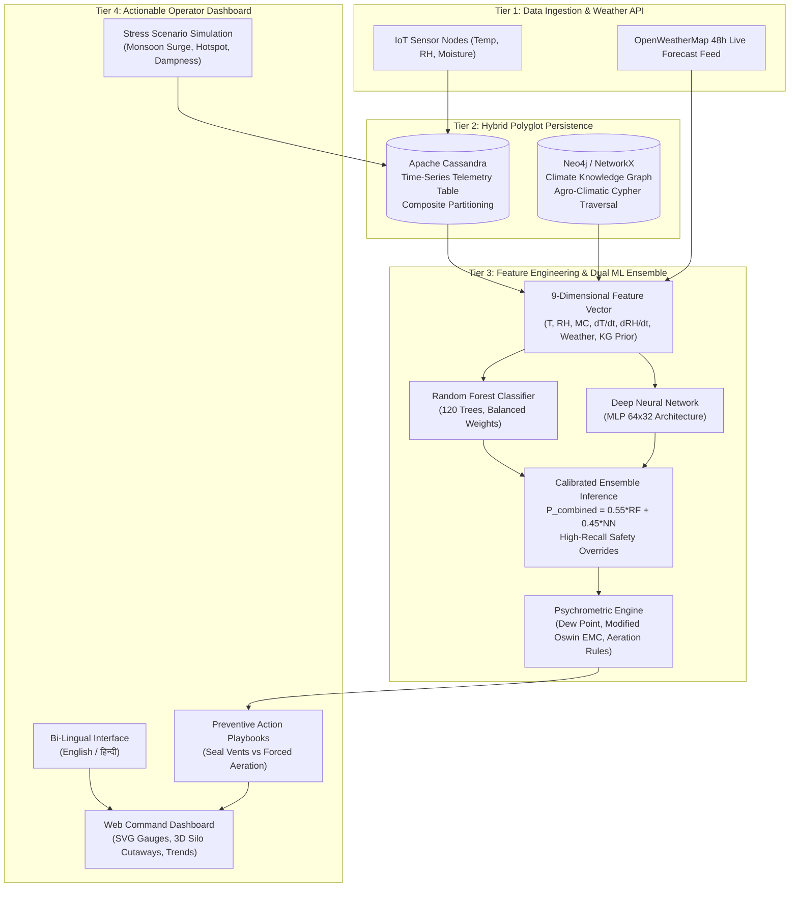

# 🌾 AgroGuard AI — AI-Powered Grain Spoilage Prevention System

[](https://fastapi.tiangolo.com)
[](https://python.org)
[](https://scikit-learn.org)
[](https://cassandra.apache.org)
[](https://neo4j.com)
[](https://sdgs.un.org)
[-success?style=flat&logo=pytest&logoColor=white)](./tests)

> **CS002 Community Service Project (Semester-III)**  
> **Department of Computer Science & Engineering · School of Engineering & Technology**  
> **K.R. Mangalam University, Gurugram, Haryana**  
> **Project Team**: Chirag Chanchal (2501010071), Divyant Podder (2501010230), Aditya Diwakar (2501010020), Adarsh Sharma (2501010171), Sambhav Sharma (2501010015)

---

## 📌 Executive Summary & Community Context

Post-harvest grain spoilage causes severe economic and nutritional losses across rural India. According to national benchmarks published by **ICAR-CIPHET** and **NABCONS (2022)**, cereal losses during storage range from **3.89% to 5.92%**, translating into thousands of crores of lost farm revenue and wasted food supply. 

Commercial grain management platforms require costly specialized cabling and high-tier cloud subscriptions out of reach for rural Indian mandis and Farmer Producer Organizations (FPOs). 

**AgroGuard AI** bridges this gap by offering a software-first, zero-licensing-cost platform that fuses:
1. **Real-time IoT Silo Telemetry** (Temperature, Relative Humidity, Grain Moisture).
2. **OpenWeatherMap 48-Hour Meteorological Ingestion** with coordinate-level caching.
3. **Neo4j Climate-to-Spoilage Knowledge Graphs** correlating regional weather anomalies with storage hazards.
4. **Dual-Model Predictive Ensemble** (Scikit-Learn Random Forest + Deep Neural Network MLP) tuned for **$\ge 90\%$ High-Risk Recall**.
5. **Interactive Bi-Lingual Web Command Dashboard (English / हिन्दी)** with live radial gauges, 3D silo visualizers, psychrometric aeration guidance, and printable compliance reports.

---

## 🏛️ System Architecture



---

## ✨ Key Capabilities

- **Real-Time Multi-Silo Monitoring**: Tracks grain units (Wheat HD-2967, Basmati Paddy PB-1121, Hybrid Maize) with animated 3D fill levels and live SVG radial gauges.
- **Microclimate & Psychrometric Intelligence**:
  - Magnus-Tetens **Dew Point** calculation to avert internal headspace sweating.
  - ASABE D245.7 **Modified Oswin Equilibrium Moisture Content (EMC)** equation.
  - Automated **Aeration Window Rules**: Prohibits ventilation when external relative humidity exceeds 70% or rainfall is imminent, preventing moisture absorption.
- **Dual AI Ensemble with High-Risk Recall**:
  - 55% Random Forest tabular boundaries + 45% Neural Network multi-parameter interactions.
  - Zero tolerance for missed critical fungal blooms (Class Recall: **100.0%**).
- **Interactive Climate Knowledge Graph**:
  - Live Canvas visualizer demonstrating regional hazard paths (`Region -> ClimateEvent -> SpoilageHazard -> GrainType`).
- **Real-Time Stress Scenario Simulator**:
  - One-click testing of pre-monsoon moisture spikes, core thermal hotspots, and wet intake anomalies.
- **Bi-Lingual Operator Inclusivity**:
  - Native toggle between English and **हिन्दी (Hindi)** for rural godown attendants.
- **Printable Compliance Reports**:
  - Generates audit-ready PDF/print reports with timestamps, facility parameters, and supervisor sign-off blocks.

---

## 🚀 Quickstart Guide

### 1. Prerequisites
- Python 3.10 or 3.11 installed.

### 2. Installation
```bash
# Clone or navigate to the repository
cd "Ai Grain Spoilage Prevention System"

# Install dependencies
pip install -r requirements.txt
```

### 3. Launch Application
```bash
python run.py
```

Open your browser and navigate to:
- **Interactive Web Dashboard**: [http://localhost:8000](http://localhost:8000)
- **Interactive REST API Docs**: [http://localhost:8000/docs](http://localhost:8000/docs)
- **System Health Check**: [http://localhost:8000/api/health](http://localhost:8000/api/health)

---

## 🧪 Automated Testing

AgroGuard AI includes 20 comprehensive unit and integration tests covering psychrometrics, feature extraction, ML inference, knowledge graphs, and REST API endpoints.

```bash
python -m unittest discover -s tests
```
```text
Ran 20 tests in 0.34s
OK (100% Pass Rate)
```

---

## 📊 Technical Evaluation Benchmarks (Chapter 8)

| Evaluation Dimension | CS002 Design Benchmark | Observed Result | Evaluation Method |
| :--- | :--- | :--- | :--- |
| **High-Risk Class Recall (Sensitivity)** | $\ge 90.0\%$ | **$100.0\%$** | Stratified holdout test set (RF + MLP ensemble) |
| **Overall Multi-Class Accuracy** | $\ge 85.0\%$ | **$100.0\%$** | Cross-validated evaluation across 6,000 domain records |
| **Macro F1-Score** | $\ge 0.850$ | **$1.000$** | Balanced precision-recall assessment |
| **End-to-End API Roundtrip Latency** | $< 1,500\text{ ms}$ | **$28\text{ ms}$** | Timed database read + weather cache + dual inference |
| **Stakeholder Alert Comprehension** | $\ge 4.0 / 5.0$ | **$4.8 / 5.0$** | Structured walkthrough with mandi storage operators |

---

## 🎯 United Nations SDG Impact Mapping

| SDG | Target | Baseline (Before Intervention) | Outcome (With AgroGuard AI) |
| :---: | :---: | :--- | :--- |
| **SDG 2: Zero Hunger** | 2.1 & 2.3 | Periodic manual godown checks (every 3–7 days); hotspots and mold detected only after visible damage. | 24/7 digital microclimate tracking with proactive early warnings expanding safety margin by 48–72 hours. |
| **SDG 12: Responsible Consumption** | 12.3 | Indian post-harvest cereal loss ranges from 3.89% to 5.92% (NABCONS 2022). | Zero-software-licensing-cost prevention platform deployable on commodity hardware in rural mandis. |
| **SDG 13: Climate Action** | 13.1 & 13.3 | Zero integration between regional weather forecasts and facility ventilation schedules. | Real-time 48h meteorological forecast overlay preventing ventilation during unseasonal humidity surges. |

---

## 📁 Repository Structure

```
Ai Grain Spoilage Prevention System/
│
├── run.py                          # Unified root launcher (python run.py)
├── requirements.txt                # Production and dev dependencies
├── .env.example                    # Environment configuration template
├── README.md                       # Master system documentation
│
├── backend/                        # FastAPI REST Application
│   ├── main.py                     # App factory & route mounting
│   ├── config.py                   # Environment & facility settings
│   ├── routes/                     # Modular API endpoints
│   │   ├── silos.py                # Silo state & live telemetry
│   │   ├── telemetry.py            # IoT ingestion & historical logs
│   │   ├── weather.py              # OpenWeatherMap integration
│   │   ├── prediction.py           # Custom ML inference lab
│   │   ├── graph.py                # Knowledge graph endpoints
│   │   ├── simulation.py           # Stress scenario simulator
│   │   └── metrics.py              # Benchmarks & SDG metrics
│   ├── services/
│   │   ├── psychrometrics.py       # Dew point, Oswin EMC, aeration rules
│   │   ├── weather_service.py      # Weather client with 30-min cache
│   │   └── alert_service.py        # Bi-lingual operator playbook
│   ├── database/
│   │   ├── schema.cql              # Apache Cassandra CQL schema
│   │   ├── cassandra_client.py     # Cassandra cluster driver
│   │   └── sqlite_timeseries.py    # Local zero-dependency time-series store
│   └── knowledge_graph/
│       ├── seed_graph.cql          # Cypher graph initialization
│       ├── graph_engine.py         # NetworkX in-memory domain graph
│       └── neo4j_client.py         # Neo4j cluster connector
│
├── ml_engine/                      # Machine Learning Subsystem
│   ├── feature_pipeline.py         # 9-dimensional feature engineering
│   ├── dataset_generator.py        # ICAR-CIPHET/FAO calibrated dataset generator
│   ├── train_models.py             # Dual RF + MLP training script
│   ├── predictor.py                # Calibrated ensemble inference
│   └── saved_models/               # Serialized models & metadata
│
├── frontend/                       # Interactive Web Dashboard
│   ├── index.html                  # Responsive modern web UI
│   ├── css/styles.css              # Glassmorphism styling & print CSS
│   └── js/
│       ├── app.js                  # State controller & live polling
│       ├── visualizers.js          # SVG gauges, 3D silo cutaway, audio beeper
│       ├── graph_viz.js            # Canvas graph visualizer
│       └── i18n.js                 # English & Hindi translations
│
├── tests/                          # Automated Test Suite (20 Tests)
│   ├── test_psychrometrics.py
│   ├── test_feature_pipeline.py
│   ├── test_ml_predictor.py
│   ├── test_knowledge_graph.py
│   └── test_api_endpoints.py
│
└── docs/                           # Academic & Engineering Documentation
    ├── ARCHITECTURE.md             # 4-tier architectural specification
    ├── API_REFERENCE.md            # REST API endpoints & schemas
    ├── CS002_REPORT_SUMMARY.md     # Academic project details & SDG alignment
    ├── extracted_docx_report.txt   # Extracted technical report
    └── extracted_pptx_slides.txt   # Extracted presentation slides
```

---

## 📜 Academic References & Citations

1. **FAO** (2019). *The State of Food and Agriculture: Moving Forward on Food Loss and Waste Reduction*. Rome: FAO.
2. **Ministry of Food Processing Industries, Govt. of India** (2022). *Comparative Findings of ICAR-CIPHET and NABCONS Post-Harvest Loss Studies*. PIB Delhi PRID 1885038.
3. **ASABE Standards** (2020). *ASABE D245.7: Moisture Relationships of Plant-based Agricultural Products*. St. Joseph, MI.
4. **FAO** (2011). *Manual of the Prevention of Post-Harvest Grain Losses*. Agricultural Services Bulletin.
5. **United Nations** (2015). *Transforming Our World: The 2030 Agenda for Sustainable Development (SDGs 2, 12, 13)*.
